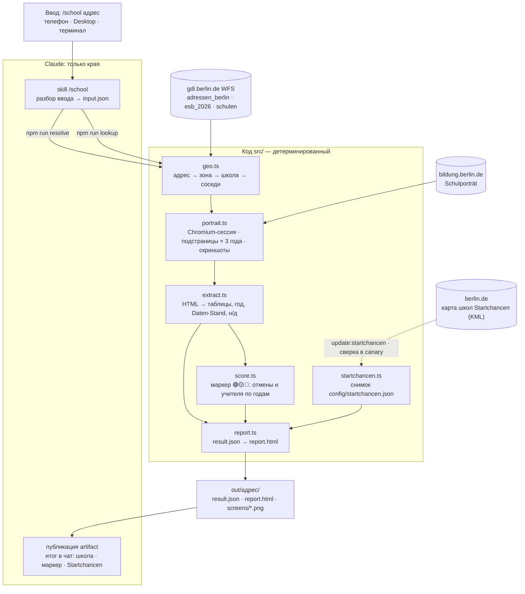

# berlin-school-researcher

[](https://github.com/maksimTrs/berlin-school-researcher/actions/workflows/ci.yml)

Адрес квартиры в Берлине → закреплённая начальная школа (Einschulbereich) → показатели Schulporträt за 3 учебных года → HTML-отчёт со скриншотами, ссылками на Google Maps и отчёты инспекции.

Показатели: отмены уроков, обеспеченность учителями, персонал, пропуски, иностранное гражданство, неродной немецкий, размер школы, откуда ученики. Источники открытые, ключи API не нужны: WFS Берлина (`gdi.berlin.de`) и [Schulverzeichnis](https://www.bildung.berlin.de/Schulverzeichnis/).

## Как запустить

| Где | Что сделать | Результат |
|---|---|---|
| Телефон / Claude Desktop / claude.ai/code | Code → Cloud → окружение `berlin-school-researcher` → репозиторий `berlin-school-researcher`, ветка `main` → сообщение `/school Katharinenstraße 3, 10711` | отчёт-artifact + итог в чат |
| Claude Code локально | в папке репозитория: `/school каштаналее 12 пренцлауэр; Bergmannstr 5 Kreuzberg` | то же самое |
| Терминал | `npm run lookup -- --address "Ruppiner Straße 47, 10115"` | `out/<адрес>/report.html` — открыть в браузере |

`/school` понимает адрес в любом виде: кириллицей, с опечатками, без PLZ, несколько через `;`. Если адрес есть в нескольких районах — спросит, какой.

## Настройка один раз

**Локально** (Node 22+):

```bash
npm ci
npx playwright install chromium
npm test && npm run canary        # юнит-тесты и полный прогон эталонного адреса
```

**Облако — GitHub** (один раз): при первой облачной сессии claude.ai предложит подключить Claude GitHub App — для публичного репозитория этого достаточно (альтернатива из терминала — `/web-setup`).

**Облако — окружение** (один раз): Claude Desktop → Code → Cloud → селектор окружения под полем ввода → **New environment** (позже — навести на окружение → значок настроек → **Edit cloud environment**):

| Поле | Значение |
|---|---|
| Name | `berlin-school-researcher` (любое) |
| Network access | **Full** — иначе закрыты gdi.berlin.de и bildung.berlin.de |
| Network secrets | не нужны |
| Environment variables | не нужны |
| Setup script | см. ниже — ставит Chromium и его системные библиотеки (кешируется) |

```bash
#!/bin/bash
npx -y playwright@1.64.1 install --with-deps chromium
```

Без `|| true`: если установка не удалась, лучше увидеть это сразу при старте сессии, чем потом получить ошибку на каждом адресе. Версия = `playwright` в `package.json`. Обновили пакет — обновите и скрипт. npm-зависимости ставить не нужно: их в каждой сессии ставит SessionStart hook (`.claude/settings.json` → `scripts/install_pkgs.sh`).

**Облако — каждый запуск:** внизу под полем ввода выбрать окружение `berlin-school-researcher` → репозиторий `<ваш-github>/berlin-school-researcher` → ветка `main` → режим **Auto** → отправить:

```text
/school Katharinenstraße 3, 10711
/school Katharinenstraße 3, 10711; каштаналее 12 пренцлауэр
```

Ожидаемо: проверка доступности сайтов → ~20 с на адрес → ссылка на artifact и итог с маркером 🟢🟡🔴 (например, «🟡 Не хватает учителей — 2 года из 3»). Модель — любая; Sonnet экономнее, вся тяжёлая работа в коде.

**По желанию — ежемесячная проверка:** Code → Scheduled → New task → Set up manually; prompt `Запусти npm run canary. Если упало — опиши подстраницу и поле, предложи исправление. Ничего не коммить.`; cron `7 9 1 * *`; Repository и Cloud environment — как выше; Connectors — убрать все.

## Архитектура



Принцип: Claude разбирает нечёткий ввод и публикует отчёт; цифры извлекает и рендерит код. Нет данных на сайте → «н/д — нет данных на сайте за <год>», без досчёта.

Как школа находится по адресу: точка адреса → зона Einschulbereich (слой `esb_2026`) → публичная Grundschule/Gemeinschaftsschule внутри зоны. Официального сопоставления «зона → школа» в WFS нет, поэтому оно пространственное:

| Ситуация | Статус | В отчёте |
|---|---|---|
| в зоне одна школа (~92 % зон) | `exact` | школа |
| несколько, код зоны совпадает с номером школы (`1105` ↔ `11G05`) | `matched_by_code` | ⚠️ эта школа |
| несколько без совпадения | `ambiguous` | ⚠️ все, полный блок — по ближайшей |
| ни одной | `no_school_in_zone` | ⚠️ 3 ближайшие к адресу |
| ручная поправка `esbOverrides` в `config/config.json` | `override` | школа из поправки |

При любом ⚠️ закреплённую школу стоит уточнить в Schulamt района.

| Файл | Что делает |
|---|---|
| `src/cli.ts` | команды `resolve`, `lookup`, `canary`, `preflight`, `startchancen`; сбой одного адреса не останавливает остальные |
| `src/preflight.ts` | проверка критичных источников до запуска браузера |
| `src/geo.ts` | WFS: адрес, зона, выбор школы, соседи |
| `src/portrait.ts` | браузер, поиск школы по номеру, загрузка подстраниц, скриншоты |
| `src/extract.ts` | список подстраниц (`PAGES`) и ключевых цифр (`KEY_FIGURES`) — новая метрика = новая строка |
| `src/score.ts` | маркер 🟢🟡🔴 за 3 года: отмены уроков хуже средней по типу школ, дефицит учительских часов — в начале отчёта и в итоге в чат |
| `src/startchancen.ts` | школа в программе Startchancen — по снимку `config/startchancen.json` |
| `src/report.ts` | HTML-отчёт |
| `config/config.json` | слой зон, число лет, соседей, адресов, адрес для canary |
| `.claude/skills/school/SKILL.md` | что делает Claude по `/school` |

## Команды

| Команда | Что |
|---|---|
| `npm run resolve -- --address "Kastanienallee 12"` | только адрес → кандидаты, без браузера |
| `npm run lookup -- --input input.json` | полный прогон по файлу адресов (формат — в `SKILL.md`) |
| `npm run canary` | эталонный адрес проходит весь путь; при поломке сайта называет подстраницу и поле; сверяет снимок Startchancen с berlin.de |
| `npm run update:startchancen` | перезаписать снимок списка Startchancen (если `canary` сказал, что список изменился) и закоммитить |
| `npm run preflight` | доступны ли критичные источники; `lookup` и `canary` проверяют это сами и при сбое не запускаются (exit code 2) |
| `npm test` | юнит-тесты на сохранённом HTML, без сети |
| `npm run test:smoke` | живые проверки адрес → зона → школа (S1–S5) |
| `npm run typecheck` | проверка типов |

CI (`.github/workflows/ci.yml`) на каждый push и PR в `main`: `npm ci` → `typecheck` → `npm test`, около 30 с. Живые сайты в CI не трогаем — их проверяют `test:smoke` и `canary`.

Отладка: `--headed --slowmo 500` — видимый браузер; `--trace` → `npx playwright show-trace out/<адрес>/trace.zip`; `PWDEBUG=1` — Playwright Inspector.
