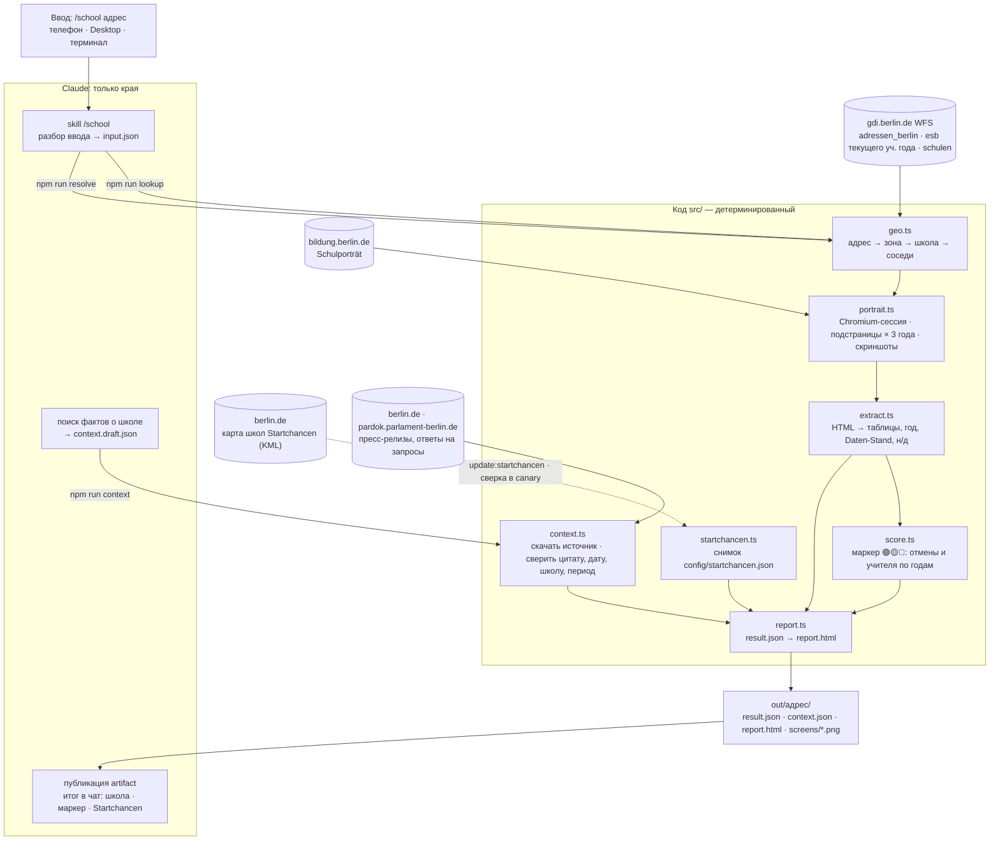

# berlin-school-researcher

[](https://github.com/maksimTrs/berlin-school-researcher/actions/workflows/ci.yml)

Адрес квартиры в Берлине → закреплённая начальная школа (Einschulbereich) → показатели Schulporträt за 3 учебных года → HTML-отчёт со скриншотами, ссылками на Google Maps и отчёты инспекции.

Показатели: отмены уроков, обеспеченность учителями, персонал, пропуски, иностранное гражданство, неродной немецкий, размер школы, откуда ученики. Источники открытые, ключи API не нужны: WFS Берлина (`gdi.berlin.de`) и [Schulverzeichnis](https://www.bildung.berlin.de/Schulverzeichnis/).

## Как запустить

| Где | Что сделать | Результат |
|---|---|---|
| Телефон / Claude Desktop / claude.ai/code | Code → Cloud → окружение `berlin-school-researcher` → репозиторий `berlin-school-researcher`, ветка `main` → сообщение `/school Katharinenstraße 3, 10711` | отчёт-artifact + итог в чат |
| Claude Code локально | в папке репозитория: `/school каштаналее 12 пренцлауэр; Bergmannstr 5 Kreuzberg` | то же самое |
| Терминал, без Claude | `npm run lookup -- --address "Ruppiner Straße 47, 10115"` | `out/<адрес>/report.html` — открыть в браузере; ограничения — [ниже](#без-claude-только-терминал) |

`/school` понимает адрес в любом виде: кириллицей, с опечатками, без PLZ, несколько через `;`. Если адрес есть в нескольких районах — спросит, какой.

Номер дома в объявлении скрыт — `/school-plz 10439`, `/school-plz Schivelbeiner Straße, 10439` или по району `/school-plz Friedenau`, несколько сразу через `;` — `/school-plz Friedenau; 12357 Berlin, Rudow; Handjerystraße, Friedenau` (до 5; запятые — части одного запроса) (терминал: `npm run plz -- --plz 10439 --street "Schivelbeiner Straße"`, `npm run plz -- --ortsteil Friedenau`). Один PLZ обычно делится между 3–5 зонами Einschulbereich, поэтому ответ — не одна школа, а все зоны: доля адресов (домов, не квартир), школа и маркер 🟢🟡🔴 каждой зоны, какие дома в какой зоне, карта зон; по району — ещё в каких PLZ лежит каждая зона (таблица «PLZ из объявления → зоны»). Точную школу даст только `/school` по полному адресу.

В обоих отчётах есть свёрнутый блок «Переезд в Берлин посреди учебного года»: как Schulamt даёт место и что детей до 7 лет без немецкого берут сразу в обычный класс — цитатами SenBJF из `config/zuzug.json`, которые `canary` сверяет с документами.

## Настройка один раз

**Локально** (Node 22.13+):

```bash
npm ci
npx playwright install chromium
npm test && npm run canary        # юнит-тесты и полный прогон эталонного адреса
```

Эти три команды — один раз после клонирования. Дальше отчёт строит `/school` (Claude Code в папке репозитория) или `npm run lookup` — см. [Без Claude](#без-claude-только-терминал).

**Облако — GitHub** (один раз): при первой облачной сессии claude.ai предложит подключить Claude GitHub App — для публичного репозитория этого достаточно (альтернатива из терминала — `/web-setup`).

**Облако — окружение** (один раз): Claude Desktop → Code → Cloud → селектор окружения под полем ввода → **New environment** (позже — навести на окружение → значок настроек → **Edit cloud environment**):

| Поле | Значение |
|---|---|
| Name | `berlin-school-researcher` (любое) |
| Network access | **Full** — иначе закрыты gdi.berlin.de и bildung.berlin.de |
| Network secrets | не нужны |
| Environment variables | не нужны |
| Setup script | см. ниже — ставит Chromium и его системные библиотеки (кешируется) |

```bash
#!/bin/bash
npx -y playwright@1.64.1 install --with-deps chromium
```

Без `|| true`: если установка не удалась, лучше увидеть это сразу при старте сессии, чем потом получить ошибку на каждом адресе. Версия = `playwright` в `package.json`. Обновили пакет — обновите и скрипт. npm-зависимости ставить не нужно: их в каждой сессии ставит SessionStart hook (`.claude/settings.json` → `scripts/install_pkgs.sh`).

**Облако — каждый запуск:** внизу под полем ввода выбрать окружение `berlin-school-researcher` → репозиторий `<ваш-github>/berlin-school-researcher` → ветка `main` → режим **Auto** → отправить:

```text
/school Katharinenstraße 3, 10711
/school Katharinenstraße 3, 10711; каштаналее 12 пренцлауэр
```

Ожидаемо: проверка доступности сайтов → ~20 с на адрес → ссылка на artifact и итог с маркером 🟢🟡🔴 (например, «🟡 Не хватает учителей — 1 год из 3»). Модель — любая; Sonnet экономнее, вся тяжёлая работа в коде.

**По желанию — ежемесячная проверка:** Code → Scheduled → New task → Set up manually; prompt `Запусти npm run canary. Если упало — опиши подстраницу и поле, предложи исправление. Ничего не коммить.`; cron `7 9 1 * *`; Repository и Cloud environment — как выше; Connectors — убрать все.

## Без Claude: только терминал

После [настройки](#настройка-один-раз) отчёт строится одной командой, без Claude Code:

```bash
npm run lookup -- --address "Katharinenstraße 3, 10711"
npm run lookup -- --input input.json      # несколько адресов, формат — в SKILL.md
```

- Отчёт: `out/<адрес>/report.html` в папке репозитория, по подпапке на адрес (например, `out/katharinenstrasse-3-10711-halensee/`). Открыть двойным кликом в браузере — скриншоты встроены в файл. Рядом `result.json` с цифрами и `screens/*.png`.
- В терминал — JSON-сводка: школа, маркер 🟢🟡🔴, Startchancen, путь к отчёту.
- Цифры и маркер те же, что через Claude: их считает код.

Чего нет без Claude:

| Через `/school` | Через `npm run lookup` |
|---|---|
| адрес в любом виде: кириллица, опечатки, текст объявления | только немецкое написание, как в объявлении: «Straße Nr, PLZ» |
| адрес есть в нескольких районах → спросит, какой | берёт первый вариант, остальные — ⚠️ в отчёте |
| ссылка на artifact и итог в чат | файл на диске, открыть самому |
| вопросы по отчёту в чате | — |

## Архитектура



Принцип: Claude разбирает нечёткий ввод и публикует отчёт; цифры извлекает и рендерит код. Нет данных на сайте → «н/д — нет данных на сайте за <год>», без досчёта. Факты из внешних источников Claude только находит; в отчёт попадает то, что код нашёл дословно в документе ведомства.

Как школа находится по адресу: точка адреса → зона Einschulbereich текущего учебного года → публичная Grundschule/Gemeinschaftsschule внутри зоны. Слой выбирает код по дате (`currentEsbLayer` в `src/config.ts`): `esb_2026` — «Schuljahr 2026/2027», с 1 августа 2027 — `esb_2027`. Слой следующего года в WFS помечен «(Planung)» и ещё может измениться — его не берём. Нового слоя к 1 августа ещё нет — `preflight` останавливает прогон, прошлогодние зоны не подставляются. Официального сопоставления «зона → школа» в WFS нет, поэтому оно пространственное:

| Ситуация | Статус | В отчёте |
|---|---|---|
| в зоне одна школа (~92 % зон) | `exact` | школа |
| несколько, код зоны совпадает с номером школы (`1105` ↔ `11G05`) | `matched_by_code` | ⚠️ эта школа — «вероятно закреплённая», остальные школы зоны — кандидаты |
| несколько без совпадения | `ambiguous` | ⚠️ все, полный блок — по ближайшей |
| ни одной | `no_school_in_zone` | ⚠️ 3 ближайшие к адресу |
| адрес вне всех зон | `no_zone` | ⚠️ 3 ближайшие к адресу |
| ручная поправка `esbOverrides` в `config/config.json` | `override` | школа из поправки |
| поправка списком — общая зона нескольких школ («Gemeinsamer ESB» в справочнике округа) | `joint` | ⚠️ все школы списка закреплены, ближайшая первой; у каждой — маркер за 3 года и проверенные факты |
| в зоне стоит школа без своей зоны (`schoolsWithoutZone`, например SESB) | по остальным школам | ℹ️ «в зоне стоит и …, своей зоны нет — в закреплённые не входит» (`withoutZone`) |

При любом ⚠️ закреплённую школу стоит уточнить в Schulamt района.

Поправки `esbOverrides` и их источники (коды зон — слоя `esb_2026`, после 1 августа 2027 сверить с `esb_2027`; `canary` проверяет, что зона есть в слое и школы — в реестре; не применилась — строка в `warnings`):

| Зона | Школы | Источник |
|---|---|---|
| `0799` | `07G40`, `07G06` | [Adressverzeichnis der ESB der Grundschulen in Tempelhof-Schöneberg ab SJ 2026/2027](https://www.berlin.de/ba-tempelhof-schoeneberg/politik-und-verwaltung/aemter/schul-und-sportamt/schulamt/adressverzeichnis-der-esb-der-grundschulen-in-ts-ab-sj-2026-2027.pdf): «Gemeinsamer ESB der 40. Schule (Grundschule) und der Sternberg-Grundschule» |

Школы без своей зоны `schoolsWithoutZone` — стоят в чужой зоне, кандидатом её не считаются. Запись — только если школа в списке SESB **и** в слое нет зоны с её кодом: у части SESB-школ (04G04, 04G15, 04G20) есть обычный набор по зоне. Код проверяет это при каждом прогоне (получила зону — снова кандидат), `canary` — что запись не устарела:

| Школа | Источник |
|---|---|
| `04G27` Judith-Kerr-Grundschule (стоит в зоне `0423` Alt-Schmargendorf) | [Anlage 1 «Schulstandorte der SESB»](https://www.berlin.de/sen/bildung/schule/besondere-schulangebote/staatliche-europaschule/anlage-1-sesb-schulstandorte.pdf); [Drs. 18/11266](https://pardok.parlament-berlin.de/starweb/adis/citat/VT/18/SchrAnfr/S18-11266.pdf): «Die SESB als Schule besonderer pädagogischer Prägung ist ein überbezirkliches Angebot, für das keine Einschulungsbereiche festgelegt sind»; зоны `0427` в слое нет |

| Файл | Что делает |
|---|---|
| `src/cli.ts` | команды `resolve`, `lookup`, `plz`, `context`, `canary`, `preflight`, `startchancen`; сбой одного адреса не останавливает остальные |
| `src/preflight.ts` | проверка критичных источников до запуска браузера |
| `src/geo.ts` | WFS: адрес, зона, выбор школы, соседи; PLZ/район → зоны (`plzZones`), сверка `esbOverrides` (`checkOverrides`) |
| `src/portrait.ts` | браузер, поиск школы по номеру, загрузка подстраниц, скриншоты |
| `src/extract.ts` | список подстраниц (`PAGES`) и ключевых цифр (`KEY_FIGURES`) — новая метрика = новая строка |
| `src/score.ts` | маркер 🟢🟡🔴 за 3 года: отмены уроков хуже средней по типу школ, дефицит учительских часов — в начале отчёта и в итоге в чат |
| `src/startchancen.ts` | школа в программе Startchancen — по снимку `config/startchancen.json` |
| `src/context.ts` | факты о школе из официальных источников: Claude находит, код скачивает документ и оставляет только дословные цитаты с датой и названием школы рядом; не больше 5 фактов, 2 на тему, сверх лимита — важные темы (`PRIORITY`); на `429` berlin.de ждёт и повторяет |
| `src/zuzug.ts` | блок «Переезд посреди учебного года» по снимку `config/zuzug.json`; `canary` сверяет цитаты |
| `src/report.ts` | HTML-отчёт |
| `config/config.json` | число лет, соседей, адресов, адрес для canary, поправки зон `esbOverrides` (коды зон — слоя текущего учебного года: после 1 августа `canary` сверяет их с новым слоем), школы без своей зоны `schoolsWithoutZone` |
| `.claude/skills/school/SKILL.md` | что делает Claude по `/school` |
| `.claude/skills/school-plz/SKILL.md` | что делает Claude по `/school-plz` |

## Команды

| Команда | Что |
|---|---|
| `npm run resolve -- --address "Kastanienallee 12"` | только адрес → кандидаты, без браузера |
| `npm run lookup -- --input input.json` | полный прогон по файлу адресов (формат — в `SKILL.md`) |
| `npm run plz -- --plz 10439 \| --ortsteil Friedenau [--street "…"]` | все зоны PLZ и/или района → `out/plz-…/` или `out/ortsteil-…/` |
| `npm run plz -- --input plz-input.json` | до 5 запросов `{ "queries": [{ "plz"?, "ortsteil"?, "street"? }, …] }` за один прогон → массив сводок; сбой одного не останавливает остальные, повтор — `skipped` |
| `npm run context -- --dir out/<адрес>` | проверить `context.draft.json` по самим документам → `context.json` и заново `report.html`; для папок `plz-…` и `ortsteil-…` — по каждой школе зон, до 3 фактов на школу |
| `npm run canary` | эталонный адрес проходит весь путь; при поломке сайта называет подстраницу и поле; сверяет снимки Startchancen и правил переезда (`config/zuzug.json`: источник официальный, цитата дословно, дата документа) с сайтами, поправки `esbOverrides` и школы без своей зоны `schoolsWithoutZone` со слоем зон и реестром школ |
| `npm run update:startchancen` | перезаписать снимок списка Startchancen (если `canary` сказал, что список изменился) и закоммитить |
| `npm run preflight` | доступны ли критичные источники; `lookup` и `canary` проверяют это сами и при сбое не запускаются (exit code 2) |
| `npm test` | юнит-тесты на сохранённом HTML, без сети |
| `npm run test:smoke` | живые проверки адрес → зона → школа (S1–S5), PLZ и район → зоны (S6–S8) |
| `npm run typecheck` | проверка типов |

CI (`.github/workflows/ci.yml`) на каждый push и PR в `main`: `npm ci` → `typecheck` → `npm test`, около 30 с. Живые сайты в CI не трогаем — их проверяют `test:smoke` и `canary`.

Отладка: `--headed --slowmo 500` — видимый браузер; `--trace` → `npx playwright show-trace out/<адрес>/trace.zip`; `PWDEBUG=1` — Playwright Inspector.
