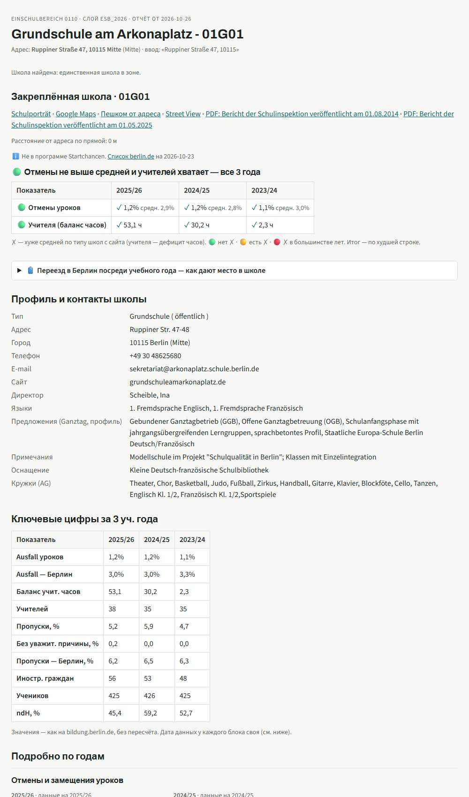
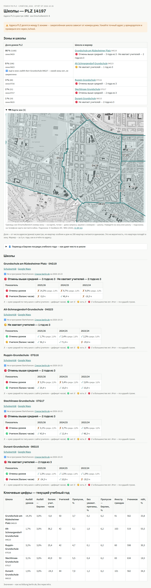
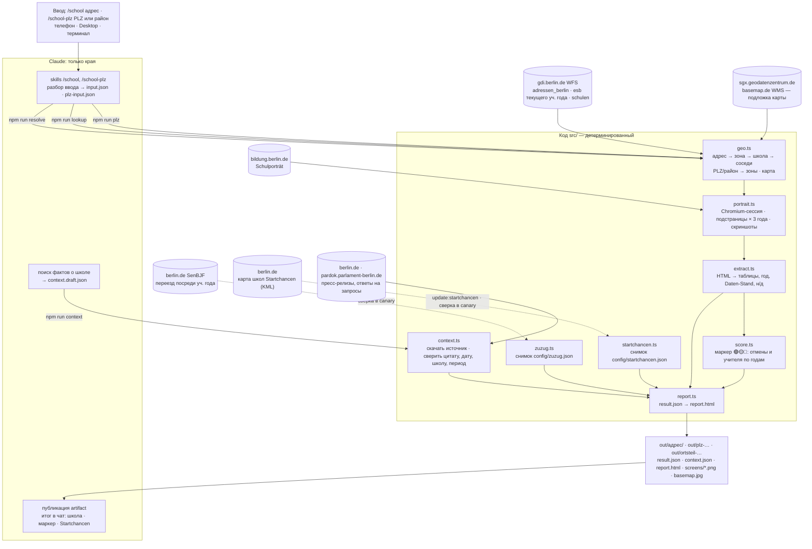

# berlin-school-researcher

[](https://github.com/maksimTrs/berlin-school-researcher/actions/workflows/ci.yml)

Адрес квартиры в Берлине → закреплённая начальная школа (Einschulbereich) → показатели Schulporträt за 3 учебных года → HTML-отчёт со скриншотами, ссылками на Google Maps и отчёты инспекции.

- **Показатели:** отмены уроков, обеспеченность учителями, персонал, пропуски, иностранное гражданство, неродной немецкий, размер школы, откуда ученики.
- **Источники** открытые, ключи API не нужны: WFS Берлина (`gdi.berlin.de`) и [Schulverzeichnis](https://www.bildung.berlin.de/Schulverzeichnis/).

## Как запустить

| Где | Что сделать | Результат |
|---|---|---|
| Телефон / Claude Desktop / claude.ai/code | Code → Cloud → окружение и репозиторий `berlin-school-researcher`, ветка `main` → `/school Katharinenstraße 3, 10711` | отчёт-artifact + итог в чат |
| Claude Code локально | в папке репозитория: `/school каштаналее 12 пренцлауэр; Bergmannstr 5 Kreuzberg` | то же самое |
| Терминал, без Claude | `npm run lookup -- --address "Ruppiner Straße 47, 10115"` | `out/<адрес>/report.html`, [ограничения](#без-claude-только-терминал) |

**`/school` — адрес известен.** Понимает любой вид: кириллицу, опечатки, без PLZ, несколько через `;`. Адрес есть в нескольких районах — спросит, какой.

**`/school-plz` — номер дома скрыт.** PLZ, район или улица с PLZ/районом; до 5 запросов через `;`, запятые — части одного запроса:

```text
/school-plz 10439
/school-plz Schivelbeiner Straße, 10439
/school-plz Friedenau; 12357 Berlin, Rudow; Handjerystraße, Friedenau
```

Один PLZ обычно делится между 3–5 зонами, поэтому ответ — все зоны:

- доля адресов (домов, не квартир), школа и маркер 🟢🟡🔴 каждой зоны, какие дома в какой зоне;
- карта зон (свёрнута) — подложка basemap.de (BKG, CC BY 4.0) вшита картинкой: artifact не грузит тайлы с чужих сайтов;
- по району — первой таблица «PLZ из объявления → школы».

Точную школу даст только `/school` по полному адресу.

В обоих отчётах есть свёрнутый блок «🧳 Переезд в Берлин посреди учебного года»: как Schulamt даёт место и что детей до 7 лет без немецкого берут сразу в обычный класс. Это цитаты SenBJF из `config/zuzug.json`, `canary` сверяет их с документами.

<details>
<summary>🏫 <b>Пример: отчёт по адресу</b> — <code>/school Ruppiner Straße 47, 10115</code></summary>

Начало отчёта: школа, маркер, профиль, ключевые цифры за 3 года. Ниже в отчёте — подробно по годам, соседние школы, скриншоты Schulporträt.



</details>

<details>
<summary>🗺️ <b>Пример: отчёт по PLZ с картой зон</b> — <code>/school-plz 14197</code></summary>

Зоны с долей адресов, карта зон поверх улиц, маркер каждой школы за 3 года, ключевые цифры. Ниже в отчёте — улицы и дома по зонам.



</details>

> Примеры — снимок от 2026-10-26: слой ESB_2026, годы 2023/24–2025/26. Построены `npm run lookup` / `npm run plz`; через скиллы добавляются факты из официальных источников.

## Настройка один раз

### Локально (Node 22.13+)

```bash
npm ci
npx playwright install chromium
npm test && npm run canary        # юнит-тесты и полный прогон эталонного адреса
```

Дальше отчёт строит `/school` в Claude Code или `npm run lookup` ([без Claude](#без-claude-только-терминал)).

### Облако

1. **GitHub:** при первой облачной сессии claude.ai предложит подключить Claude GitHub App — для публичного репозитория этого достаточно (или `/web-setup` из терминала).
2. **Окружение:** Claude Desktop → Code → Cloud → селектор окружения под полем ввода → **New environment** (изменить — навести на окружение → значок настроек → **Edit cloud environment**):

   | Поле | Значение |
   |---|---|
   | Name | `berlin-school-researcher` (любое) |
   | Network access | **Full** — иначе закрыты gdi.berlin.de и bildung.berlin.de |
   | Network secrets, Environment variables | не нужны |
   | Setup script | ниже — Chromium с системными библиотеками, кешируется |

   ```bash
   #!/bin/bash
   npx -y playwright@1.64.1 install --with-deps chromium
   ```

   - Версия = `playwright` в `package.json`: обновили пакет — обновите скрипт.
   - Без `|| true`: сбой установки виден сразу при старте сессии, а не ошибкой на каждом адресе.
   - npm-зависимости ставит SessionStart hook (`.claude/settings.json` → `scripts/install_pkgs.sh`).
3. **Каждый запуск:** под полем ввода — окружение `berlin-school-researcher` → репозиторий `<ваш-github>/berlin-school-researcher` → ветка `main` → режим **Auto** → отправить:

   ```text
   /school Katharinenstraße 3, 10711
   /school Katharinenstraße 3, 10711; каштаналее 12 пренцлауэр
   ```

   Ожидаемо: проверка сайтов → ~20 с на адрес → ссылка на artifact и итог с маркером, например «🟡 Не хватает учителей — 1 год из 3». Модель любая; Sonnet экономнее — тяжёлая работа в коде.
4. **По желанию — ежемесячная проверка:** Code → Scheduled → New task → Set up manually:

   | Поле | Значение |
   |---|---|
   | Prompt | `Запусти npm run canary. Если упало — опиши подстраницу и поле, предложи исправление. Ничего не коммить.` |
   | Cron | `7 9 1 * *` |
   | Repository, Cloud environment | как выше |
   | Connectors | убрать все |

## Без Claude: только терминал

После [настройки](#настройка-один-раз) — одна команда, ~20 с:

```bash
npm run lookup -- --address "Katharinenstraße 3, 10711"         # по адресу
npm run lookup -- --input input.json                            # несколько адресов, формат — в SKILL.md
npm run plz -- --plz 14197                                      # номер дома неизвестен: все зоны PLZ
npm run plz -- --ortsteil Friedenau --street "Handjerystraße"   # или района / улицы в нём
```

| | По адресу (`lookup`) | По PLZ / району (`plz`) |
|---|---|---|
| Отчёт | `out/<адрес>/report.html`, например `out/katharinenstrasse-3-10711-halensee/` | `out/plz-14197/report.html`, `out/ortsteil-friedenau-handjerystrasse/report.html` |
| Рядом | `result.json`, `screens/*.png` (скриншоты встроены и в отчёт) | `result.json`, `basemap.jpg`, скриншотов нет |
| В терминал | JSON: школа, маркер 🟢🟡🔴, Startchancen, путь к отчёту | JSON: адресов, зоны, школа и маркер каждой, путь к отчёту |

Отчёт открывается двойным кликом в браузере. Цифры и маркер те же, что через Claude: их считает код.

Чего нет без Claude:

| Через `/school`, `/school-plz` | Через `npm run lookup`, `npm run plz` |
|---|---|
| адрес в любом виде: кириллица, опечатки, текст объявления | только «Straße Nr, PLZ» по-немецки; неверный PLZ → `not_found` |
| 📌 факты из официальных источников и 🗓 дальние планы стройки: ищет Claude, код сверяет с документом | нет |
| адрес в нескольких районах → спросит, какой | берёт первый, остальные — ⚠️ в отчёте |
| ссылка на artifact и итог в чат, вопросы по отчёту | файл на диске, открыть самому |

## Архитектура



**Принцип:** Claude разбирает нечёткий ввод и публикует отчёт; цифры извлекает и рендерит код.

- Нет данных на сайте → «н/д — нет данных на сайте за <год>», без досчёта.
- Факты из внешних источников Claude только находит; в отчёт попадает то, что код нашёл дословно в документе ведомства.

### Как школа находится по адресу

Точка адреса → зона Einschulbereich текущего учебного года → публичная Grundschule/Gemeinschaftsschule внутри зоны.

- **Слой** выбирает код по дате (`currentEsbLayer` в `src/config.ts`): `esb_2026` — «Schuljahr 2026/2027», с 1 августа 2027 — `esb_2027`.
- Слой следующего года помечен в WFS «(Planung)» и ещё может измениться — его не берём.
- Нового слоя к 1 августа нет — `preflight` останавливает прогон, прошлогодние зоны не подставляются.
- Официального сопоставления «зона → школа» в WFS нет, поэтому оно пространственное:

| Ситуация | Статус | В отчёте |
|---|---|---|
| в зоне одна школа (~92 % зон) | `exact` | школа |
| одна Grundschule, но номер не совпадает с кодом зоны (вне Mitte¹) — вероятно, закреплена за соседней зоной | `code_mismatch` | ⚠️ школа в зоне и школа с номером зоны — кандидаты |
| несколько, код зоны = номер Grundschule (`1105` ↔ `11G05`; вне Mitte) | `matched_by_code` | ⚠️ эта — «вероятно закреплённая», остальные — кандидаты |
| несколько без совпадения | `ambiguous` | ⚠️ все, полный блок — по ближайшей |
| ни одной / адрес вне всех зон | `no_school_in_zone` / `no_zone` | ⚠️ 3 ближайшие к адресу |
| ручная поправка `esbOverrides` | `override` | школа из поправки |
| поправка списком — общая зона («Gemeinsamer ESB» в справочнике округа) | `joint` | ⚠️ все школы списка, ближайшая первой; у каждой маркер и факты |
| в зоне стоит школа без своей зоны (`schoolsWithoutZone`, например SESB) | по остальным школам | ℹ️ «в зоне стоит и …, своей зоны нет» (`withoutZone`) |

¹ У Mitte своя нумерация зон, у Gemeinschaftsschule — своя схема.

При любом ⚠️ закреплённую школу стоит уточнить в Schulamt района.

### Ручные поправки

**`esbOverrides`** (`config/config.json`). Коды зон — слоя `esb_2026`, после 1 августа 2027 сверить с `esb_2027`. `canary` проверяет, что зона есть в слое и школы — в реестре; не применилась — строка в `warnings`.

| Зона | Школы | Источник |
|---|---|---|
| `0799` | `07G40`, `07G06` | [Adressverzeichnis der ESB der Grundschulen in Tempelhof-Schöneberg ab SJ 2026/2027](https://www.berlin.de/ba-tempelhof-schoeneberg/politik-und-verwaltung/aemter/schul-und-sportamt/schulamt/adressverzeichnis-der-esb-der-grundschulen-in-ts-ab-sj-2026-2027.pdf): «Gemeinsamer ESB der 40. Schule (Grundschule) und der Sternberg-Grundschule» |
| `0457` | `04S07` | [Bezirksamt Charlottenburg-Wilmersdorf, Beschluss 17.06.2025, VzB 210, Anlage 1 «Zuschneidung der Einschulungsbereiche»](https://www.berlin.de/ba-charlottenburg-wilmersdorf/politik/bezirksamt/beschluesse/6-wahlperiode/2025/164_ba_n_bproto_250617_vzb-210_anlage-1.pdf): «Die Schaffung eines Einschulungsbereichs an der Comenius-Schule reduziert das Defizit der Katharina-Heinroth-Grundschule, indem der Einschulungsbereich südlich des Hohenzollerndamms geteilt und fortan der Comenius-Schule zugerechnet wird»² |

² Comenius-Schule — единственная школа в зоне, код 04S07 ↔ 0457. Тип — Förderschwerpunkt, поэтому без поправки её нет среди кандидатов (только Grundschule/Gemeinschaftsschule); школа из поправки берётся из реестра любого типа.

**`schoolsWithoutZone`** — школа стоит в чужой зоне и кандидатом её не считается. Запись — только если школа в списке SESB **и** в слое нет зоны с её кодом: у части SESB-школ (04G04, 04G15, 04G20) обычный набор по зоне. Код проверяет это при каждом прогоне (получила зону — снова кандидат), `canary` — что запись не устарела.

| Школа | Источник |
|---|---|
| `04G27` Judith-Kerr-Grundschule (в зоне `0423` Alt-Schmargendorf) | [Anlage 1 «Schulstandorte der SESB»](https://www.berlin.de/sen/bildung/schule/besondere-schulangebote/staatliche-europaschule/anlage-1-sesb-schulstandorte.pdf); [Drs. 18/11266](https://pardok.parlament-berlin.de/starweb/adis/citat/VT/18/SchrAnfr/S18-11266.pdf): «Die SESB als Schule besonderer pädagogischer Prägung ist ein überbezirkliches Angebot, für das keine Einschulungsbereiche festgelegt sind»; зоны `0427` в слое нет |

### Файлы

| Файл | Что делает |
|---|---|
| `src/cli.ts` | команды `resolve`, `lookup`, `plz`, `context`, `canary`, `preflight`, `startchancen`; сбой одного адреса не останавливает остальные |
| `src/preflight.ts` | проверка критичных источников до запуска браузера |
| `src/geo.ts` | WFS: адрес, зона, выбор школы, соседи; PLZ/район → зоны (`plzZones`), подложка basemap.de (`basemap`), сверка `esbOverrides` (`checkOverrides`) |
| `src/portrait.ts` | браузер, поиск школы по номеру, подстраницы, скриншоты |
| `src/extract.ts` | список подстраниц (`PAGES`) и ключевых цифр (`KEY_FIGURES`) — новая метрика = новая строка |
| `src/score.ts` | маркер 🟢🟡🔴 за 3 года: отмены хуже средней по типу школ, дефицит учительских часов |
| `src/startchancen.ts` | школа в программе Startchancen — по снимку `config/startchancen.json` |
| `src/context.ts` | факты из официальных источников — подробнее ниже |
| `src/zuzug.ts` | блок «Переезд посреди учебного года» по снимку `config/zuzug.json` |
| `src/report.ts` | HTML-отчёт |
| `config/config.json` | число лет, соседей, адресов; адрес для canary; окно и лимиты фактов `context`; `esbOverrides`, `schoolsWithoutZone` |
| `.claude/skills/school/SKILL.md`, `.claude/skills/school-plz/SKILL.md` | что делает Claude по `/school` и `/school-plz` |

`src/context.ts` — Claude находит факты, код скачивает документ и оставляет только дословные цитаты с датой и названием школы рядом:

- не больше 5 фактов, 2 на тему; сверх лимита остаются важные темы (`PRIORITY`);
- окно: публикации за 12 мес., планы на 6 мес. вперёд, стройка — на 72 мес. (годы начальной школы; `pastMonths`, `futureMonths`, `constructionFutureMonths`);
- планы позже 6 мес. — строкой «🗓 Дальние планы», по лимиту уходит первой;
- на `429` berlin.de ждёт и повторяет.

## Команды

| Команда | Что |
|---|---|
| `npm run resolve -- --address "Kastanienallee 12"` | только адрес → кандидаты, без браузера |
| `npm run lookup -- --input input.json` | полный прогон по файлу адресов (формат — в `SKILL.md`) |
| `npm run plz -- --plz 10439 \| --ortsteil Friedenau [--street "…"]` | все зоны PLZ и/или района → `out/plz-…/` или `out/ortsteil-…/` |
| `npm run plz -- --input plz-input.json` | до 5 запросов `{ "queries": [{ "plz"?, "ortsteil"?, "street"? }, …] }` → массив сводок; сбой одного не останавливает остальные, повтор — `skipped` |
| `npm run context -- --dir out/<адрес>` | `context.draft.json` → проверка по документам → `context.json` и заново `report.html`; `plz-…` / `ortsteil-…` — по каждой школе зон, до 3 фактов на школу |
| `npm run canary` | эталонный адрес проходит весь путь, при поломке сайта — подстраница и поле; сверяет снимки Startchancen и `config/zuzug.json` (официальный источник, дословная цитата, дата документа), `esbOverrides` и `schoolsWithoutZone` — со слоем зон и реестром школ |
| `npm run update:startchancen` | перезаписать снимок Startchancen (когда `canary` сказал, что список изменился) и закоммитить |
| `npm run preflight` | доступны ли критичные источники; `lookup` и `canary` проверяют сами и при сбое не запускаются (exit code 2) |
| `npm test` | юнит-тесты на сохранённом HTML, без сети |
| `npm run test:smoke` | живые проверки: адрес → зона → школа (S1–S5), PLZ и район → зоны (S6–S8) |
| `npm run typecheck` | проверка типов |

**CI** (`.github/workflows/ci.yml`), каждый push и PR в `main`: `npm ci` → `typecheck` → `npm test`, ~30 с. Живые сайты в CI не трогаем — их проверяют `test:smoke` и `canary`.

**Отладка:** `--headed --slowmo 500` — видимый браузер; `--trace` → `npx playwright show-trace out/<адрес>/trace.zip`; `PWDEBUG=1` — Playwright Inspector.
